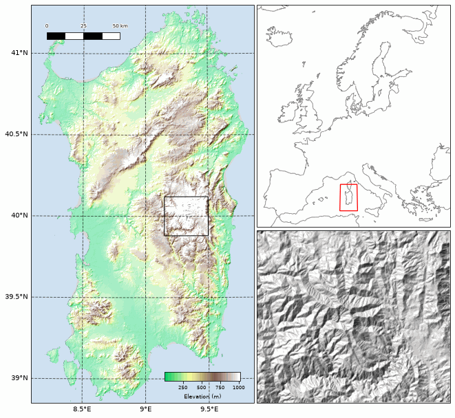

# 🍃 plotea

Publication-quality maps, with the choices a map needs made for you: the projection taken
from your data, a scale bar at the right length, a colorbar that fits the axes, panels that
stay aligned.

It wraps `matplotlib` and `cartopy` for drawing and `rasterio`/`rioxarray` for reading, and
complements cartopy rather than replacing it — cartopy projects axes and draws coastlines,
plotea composes the figure.



One screen of code, on a DEM that ships with the repository. See
[`notebooks/plotea.ipynb`](notebooks/plotea.ipynb) for that figure and everything else.

## Installation

```bash
git clone https://github.com/kmch/plotea.git                   # clone this repo
cd plotea                                                       # navigate to the repo directory
conda env create -f environment.yml                             # create a `plotea` conda environment; it installs plotea itself too, editable
conda activate plotea                                           # activate the environment
python -c "import plotea; print(plotea.__file__)"               # check the installation: the path printed is in this clone
```

To add plotea to an environment that already has its dependencies, such as `accuml`'s or
watersmartml's (`wsml`):

```bash
pip install --no-deps git+https://github.com/kmch/plotea.git   # the latest commit, not editable
pip install --no-deps -e ~/software/plotea                     # or from a clone, editable
```

`--no-deps` keeps pip from installing its own builds of GDAL, PROJ and GEOS over
conda-forge's. Without conda, `pip install -e .` in the clone takes the dependencies from
`pyproject.toml`. The extras are `.[dggs]` for the HEALPix layer, `.[dev]` for the tests and
`.[docs]` to build the documentation; `environment.yml` has all three.

## Quick start

Everything below runs as written, on the DEM that ships with the repository.

```python
import plotea
from plotea import BaseMap, Raster, land_terrain, scalebar

fig, ax = BaseMap().plot()                         # the world, country outlines, Equal Earth

dem = Raster(plotea.PATH.datasets / 'sardinia_elv.tif', label='Elevation', unit='m')

fig, ax = BaseMap(**dem.basemap_options()).plot()  # view and projection from the raster
dem.plot(ax=ax, cmap=land_terrain(), blend_mode='hsv', cbar=True)
scalebar(ax, length_km=50)

dem.info                                 # what the file is; .details adds the value range
window = dem.read_window(max_px=2000)    # or every=10, a stride; a DataArray with its own footprint
window.plotea.extent                     # cell edges, ready for imshow
```

### Seismic plots

`plotea.seismic` draws what is not a map: a field over x and depth (`Section`), traces over
time as an image (`Gather`) and a single trace (`Trace`), each from an xarray DataArray, with
depth and time running down the page. fwipy uses it for its models, snapshots and gathers.

```python
from plotea.seismic import Gather, PhaseMap, Section, Trace

fig, ax = Section(model.vp).plot(label='P-wave velocity (m/s)')   # dims ('z', 'x'), in metres
fig, ax = Section(snapshot).plot(symmetric=True)                  # RdBu_r, white at zero
fig, ax = Gather(gather).plot(clip=99)                            # dims ('receiver', 'time'), seconds
fig, ax = Trace(wavelet).plot()                                   # dim 'time'
fig, ax = PhaseMap(residual).plot(source=(x, z))                  # dim 'receiver', radians, at the receivers' positions
```

## How to

### Overlay water-quality sites on stream-pixel predictions

Two layers of points on one map: the stream pixels, small and drawn first, and the sampling
sites on top of them as larger circles with a black edge, so that a site stands out even
where its colour matches the river under it. Both are plain `ax.scatter` calls. The axes
`BaseMap.plot` returns read untransformed coordinates as longitude and latitude in any
projection, so neither layer needs `transform=`.

The example reads watersmartml's outputs: a model's predictions at every stream pixel
(`prediction_<model>_europe.parquet`, one point per pixel with `geometry` and `prediction`),
and its out-of-fold predictions at the sites (`predictions_out_of_fold.parquet` in the model's
directory, with `longitude`, `latitude`, `observed`, `predicted` and `residual`). Any two
tables with coordinates and a value work the same way. Reading Parquet needs `pyarrow`, which
`environment.yml` and the `wsml` environment include.

When the sites carry measurements, they are the same quantity as the predictions, so both
layers share one colour scale and one colour bar, and a site compares with the river under it
by colour:

```python
import numpy as np
import pandas as pd
import pyarrow.parquet as pq
import shapely
from matplotlib.colors import Normalize
from plotea import BaseMap, Colorbar, scalebar

path_pixels = 'prediction_<model>_europe.parquet'
path_sites  = 'predictions_out_of_fold.parquet'
bbox        = [-1.5, 43.0, 3.5, 46.0]                                 # minx, miny, maxx, maxy in degrees

kept = []                                                              # read the pixels in batches, keeping those in the box
for batch in pq.ParquetFile(path_pixels).iter_batches(batch_size=1_000_000, columns=['geometry', 'prediction']):
    xy    = shapely.get_coordinates(shapely.from_wkb(batch['geometry'].to_numpy(zero_copy_only=False)))
    batch = pd.DataFrame({'lon': xy[:, 0], 'lat': xy[:, 1], 'prediction': batch['prediction'].to_numpy()})
    kept.append(batch[batch.lon.between(bbox[0], bbox[2]) & batch.lat.between(bbox[1], bbox[3])])
pixels = pd.concat(kept, ignore_index=True)
sites  = pd.read_parquet(path_sites)
sites  = sites[sites.longitude.between(bbox[0], bbox[2]) & sites.latitude.between(bbox[1], bbox[3])]

norm    = Normalize(0, np.nanpercentile(pixels.prediction, 98))       # one scale for both layers
fig, ax = BaseMap(bbox=bbox).plot()
image   = ax.scatter(pixels.lon, pixels.lat, c=pixels.prediction, cmap='viridis', norm=norm, s=0.7, linewidths=0, zorder=3, rasterized=True)
ax.scatter(sites.longitude, sites.latitude, c=sites.observed, cmap='viridis', norm=norm, s=14, edgecolors='black', linewidths=0.6, zorder=4)
ax.scatter([], [], s=14, facecolor='white', edgecolors='black', linewidths=0.6, label=f'{len(sites):,} sites, observed')
ax.legend(loc='upper left', fontsize=7, framealpha=0.9, edgecolor='none')
Colorbar.attach(image, ax, label='Total nitrogen (mg/l)')
scalebar(ax)
fig.savefig('overlay_observed.png', dpi=300, bbox_inches='tight')
```

When the sites carry residuals, they are a different quantity, so they get a scale of their
own: a diverging one centred on zero with equal limits either side, and a second colour bar
under the map. The sites are sorted so that the largest residuals are drawn last, on top. In
`predictions_out_of_fold.parquet` the residual is predicted minus observed, so red is
over-prediction:

```python
sites   = sites.loc[sites.residual.abs().sort_values().index]
limit   = np.nanpercentile(sites.residual.abs(), 98)
fig, ax = BaseMap(bbox=bbox).plot()
image   = ax.scatter(pixels.lon, pixels.lat, c=pixels.prediction, cmap='viridis', norm=norm, s=0.7, linewidths=0, zorder=3, rasterized=True)
dots    = ax.scatter(sites.longitude, sites.latitude, c=sites.residual, cmap='RdBu_r', norm=Normalize(-limit, limit), s=14, edgecolors='black', linewidths=0.6, zorder=4)
Colorbar.attach(image, ax, label='Predicted total nitrogen (mg/l)')
Colorbar.attach(dots, ax, label='Residual, predicted − observed (mg/l)', orientation='horizontal', pad=0.08)
scalebar(ax)
fig.savefig('overlay_residuals.png', dpi=300, bbox_inches='tight')
```

What the choices are for:

- **Marker sizes.** `s` is a marker's area in points², fixed on the page whatever the map
  shows, so it is set per map. On a box a few degrees across, as here, 0.7 for the pixels and
  14 for the sites makes a site about 4.5 times a pixel's diameter. For a larger area, shrink
  both and keep the ratio; at `s=24` the 1,899 sites in this box hid most of the network.
- **Colour limits.** Both scales stop at the 98th percentile, so a few extreme values do not
  flatten the rest; anything beyond takes the end colour.
- **`zorder`.** The pixels at 3 sit above the land and below the sites at 4.
- **`rasterized=True`.** A PDF or SVG then holds the pixels as one image while the sites,
  coastlines and text stay vector, so the file stays small.
- **Reading in batches.** The European prediction file holds 26 M pixels. Read whole into a
  GeoDataFrame and cut to the box, it peaked at 7.7 GB of memory; in batches of a million,
  keeping only the box, at 0.8 GB, in 26 s (5 November 2026, the box above: 569,116 pixels).

## Citing

If you use any part of this repository in your research, please cite:

> Chrapkiewicz K., Lipp A.G., Barron L.P., Barnes R., Roberts G.G. (2024). **Apportioning
> sources of chemicals of emerging concern along an urban river with inverse modelling.**
> *Science of the Total Environment*. https://doi.org/10.1016/j.scitotenv.2024.172827

```bibtex
@article{chrapkiewicz2024apportioning,
  author  = {Chrapkiewicz, Kajetan and Lipp, Alex G. and Barron, Leon P. and
             Barnes, Richard and Roberts, Gareth G.},
  title   = {Apportioning sources of chemicals of emerging concern along an urban
             river with inverse modelling},
  journal = {Science of the Total Environment},
  year    = {2024},
  doi     = {10.1016/j.scitotenv.2024.172827},
}
```
