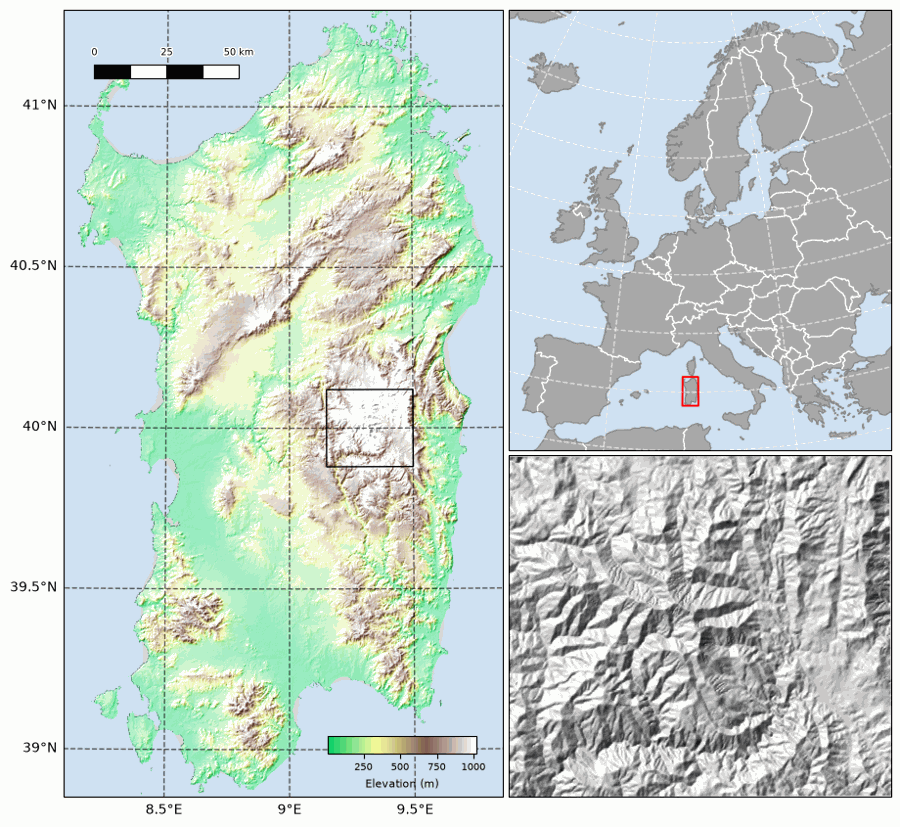

# 🍃 plotea

Publication-quality maps, with the choices a map needs made for you: the projection taken
from your data, a scale bar at the right length, a colorbar that fits the axes, panels that
stay aligned.

It wraps `matplotlib` and `cartopy` for drawing and `rasterio`/`rioxarray` for reading, and
complements cartopy rather than replacing it — cartopy projects axes and draws coastlines,
plotea composes the figure.



One screen of code, on a DEM that ships with the repository. See
[`notebooks/plotea.ipynb`](notebooks/plotea.ipynb) for that figure and everything else.

## Installation

```bash
git clone git@github.com:kmch/plotea.git && cd plotea && pip install -e .
```

Extras: `.[dggs]` for the HEALPix layer, `.[dev]` for the tests, `.[docs]` to build the
documentation.

## Quick start

Everything below runs as written, on the DEM that ships with the repository.

```python
import plotea
from plotea import BaseMap, Raster, land_terrain, scalebar

fig, ax = BaseMap().plot()                         # the world, country outlines, Equal Earth

dem = Raster(plotea.PATH.datasets / 'sardinia_elv.tif', label='Elevation', unit='m')

fig, ax = BaseMap(**dem.basemap_options()).plot()  # view and projection from the raster
dem.plot(ax=ax, cmap=land_terrain(), blend_mode='hsv', cbar=True)
scalebar(ax, length_km=50)

dem.info                                 # what the file is; .details adds the value range
window = dem.read_window(max_px=2000)    # or every=10, a stride; a DataArray with its own footprint
window.plotea.extent                     # cell edges, ready for imshow
```

## Citing

If you use any part of this repository in your research, please cite:

> Chrapkiewicz K., Lipp A.G., Barron L.P., Barnes R., Roberts G.G. (2024). **Apportioning
> sources of chemicals of emerging concern along an urban river with inverse modelling.**
> *Science of the Total Environment*. https://doi.org/10.1016/j.scitotenv.2024.172827

```bibtex
@article{chrapkiewicz2024apportioning,
  author  = {Chrapkiewicz, Kajetan and Lipp, Alex G. and Barron, Leon P. and
             Barnes, Richard and Roberts, Gareth G.},
  title   = {Apportioning sources of chemicals of emerging concern along an urban
             river with inverse modelling},
  journal = {Science of the Total Environment},
  year    = {2024},
  doi     = {10.1016/j.scitotenv.2024.172827},
}
```
